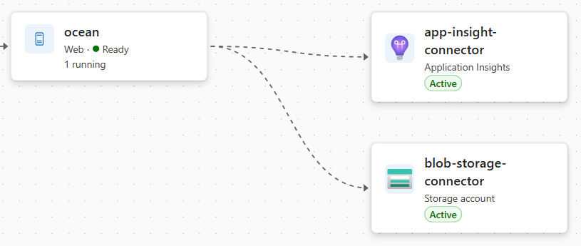

# little ocean

A small browser game hosted on **[Azure App Service Builder](https://builder.appservice.azure.com/docs/)**.
It keeps gameplay lightweight while using Azure for shared statistics and
monitoring.

[Play the live preview](https://littleocean-3b5a7dee.app.westus2.builderapps.dev/)
| [Deployment guide](DEPLOYMENT.md)

> App Service Builder is in preview and intended for development/test workloads.

## How it's built

### From GitHub to Azure

Builder connects to the repository and uses [`builder.yaml`](builder.yaml) to
build and deploy a Python web component. The component serves both the game and
a small same-origin API. Builder provides deployment history, health checks,
and scaling, including the ability to scale to zero when idle.



### Shared data and monitoring

The browser game uses HTML, CSS, JavaScript, Canvas, and Web Audio. Its
community counters are backed by Azure Blob Storage: temporary adventure IDs
and expiring leases estimate how many adventures are active, while conditional
writes help avoid lost updates. Counts represent adventures, not unique people.

Application Insights receives aggregate metrics, and the app uses managed
identity to access Azure services without storage account keys. A single Blob
keeps the design simple for a small showcase, but contention grows with traffic.

## Run locally

Open `index.html` in a modern browser to play without shared statistics.
For temporary in-memory counters, run:

```shell
python -m server.app --demo
```

Open <http://localhost:8080>. Counters reset when the server restarts. Use arrow
keys or WASD to swim, Space for a bubble burst, and Escape to pause; touch
controls are also available.

See [DEPLOYMENT.md](DEPLOYMENT.md) for Azure setup, verification, privacy
considerations, and backend tests.
